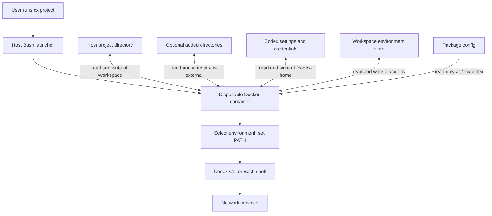

# System map and access model

## The parts

```text
cx package/
├── cx                    Portable entry point; selects bundle-local data
├── install.sh            Installs the program for the current user
├── uninstall.sh          Removes managed program files, preserving user data
├── VERSION               Human-readable package version
├── bin/cx                Main host launcher, also used by installed cx
├── config/config.toml    Default Codex environment instructions
├── container/
│   ├── Dockerfile        Builds the Node/Codex/Micromamba image
│   ├── cx-entrypoint     Selects the development environment and starts a process
│   ├── cx-env            Inspects and selects persistent environments
│   └── .dockerignore     Restricts the build context to image source files
├── docs/                 Installation, usage, architecture, and maintenance
├── scripts/              Release packaging
└── tests/                Offline regression suite
```

The installed `PREFIX/bin/cx` is a symlink to
`PREFIX/share/cx/program/bin/cx`. That launcher finds its package using its real
path. `program/config` is a symlink to `PREFIX/share/cx/config`, so upgrades can
replace code while keeping the system configuration. Portable mode uses the
same `bin/cx`, reached through the top-level `cx` wrapper.

## One session



No Codex server runs on your host for this package. The Docker image contains
Node 24 on Debian Bookworm, the Codex CLI, Micromamba, Git, ripgrep, jq, curl,
SSH client tools, bubblewrap, Bash, and tini. It does not contain a full Python
or application development environment; create one in `/cx-env` as needed.

## What persists

| Container path | Host source | Lifetime |
|---|---|---|
| `/workspace` | Selected project | Permanent project changes |
| `/cx-external/...` | `--add-dir` folders | Permanent changes to added files |
| `/codex-home` | `CX_CODEX_HOME` | Credentials, preferences, and Codex session state |
| `/cx-env` | Workspace subfolder of `CX_ENV_HOME` | Named environments, caches, and saved selection |
| `/etc/codex` | Package config directory | Read-only input during Codex runs |
| `/home/codex`, `/tmp` | Container tmpfs | Discarded after the process exits |

The workspace store's name combines a sanitized project basename with the
first 16 hexadecimal digits of SHA-256 of its canonical absolute path. Its
`workspace-path` text file records that path for human inspection. `active`
holds one environment name. Micromamba environments live under `envs/`.
The wrapper creates no package environment automatically.

## Access and limits

The launcher uses Docker as the outer boundary and starts Codex with
`--sandbox danger-full-access` inside it, preserving the supplied design.
Codex can modify shared projects, extra directories, its credential store,
and persistent development environments. Its subprocesses have the same
access. Container networking is enabled. Run it only against files and data
you intend the agent to access.

Containers use your numeric UID/GID, a read-only root filesystem, dropped
Linux capabilities, `no-new-privileges`, and temporary home and `/tmp` mounts.
Normal Codex runs additionally have configurable memory, CPU, and process
limits and a file-descriptor limit. Shell and authentication containers have
the original lighter set of limits. No Docker socket, SSH agent, host root,
or arbitrary host home directory is automatically mounted.

`.codexignore` adds empty overlays at named paths. It does not erase files,
hide names, or prevent access through aliases such as hard links or other
mounts. It is a convenience for ordinary layouts, not a complete secret
management system. Mount errors fail the Docker command rather than retrying
without the requested masks.

Docker and the host administrator remain trusted components. Credentials are
writable inside the container because login refreshes need to persist. The
system config's package-approval wording is an agent instruction and can be
overridden by higher-priority Codex configuration. It is not a kernel policy.

The release process copies an explicit list of source files. It never copies
`data/`, `.codex/`, the supplied external environment stores, or host settings.
Never distribute a used portable folder wholesale: its `data/codex` may contain
access tokens, and its environment store can contain project data.
