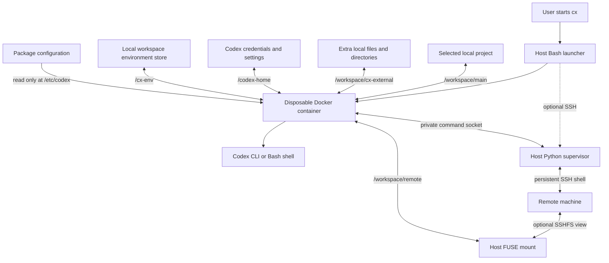

# System map and access model

## Package layout

```text
cx package/
├── cx                    Portable entry point; selects bundle-local data
├── bin/
│   ├── cx                Host launcher used by both editions
│   └── cx-ssh-bridge.py   Optional host SSH/terminal/filesystem supervisor
├── config/config.toml    Default Codex developer instructions
├── container/
│   ├── Dockerfile        Node/Codex/Micromamba image
│   ├── cx-entrypoint     Select environment and start the requested process
│   ├── cx-env            Inspect and select persistent environments
│   ├── cx-remote         Container client for the host SSH bridge
│   └── .dockerignore     Restrict image build inputs
├── install.sh            Install or upgrade managed program files
├── uninstall.sh          Remove managed code; preserve configuration/data
├── VERSION               Package release version
├── docs/                 User and maintainer guides
├── scripts/              Release packaging and live Docker checks
└── tests/                Offline regression suites
```

Installed `PREFIX/bin/cx` is a symlink to `PREFIX/share/cx/program/bin/cx`.
That launcher resolves its real path. `program/config` links to the preserved
`PREFIX/share/cx/config`, so upgrades replace code independently of settings.
Portable mode reaches the same launcher through the top-level `cx` wrapper.

## Session data flow



Sessions start at `/workspace`, a container directory containing `main/`,
`cx-external/`, and `remote/`. The selected project mounts at `main/`; the
other folders are empty until used. The parent and unused placeholders are
read-only. No corresponding folders are created in the host project.

The image contains Node 24 on Debian Bookworm, Codex CLI, Micromamba, Git,
ripgrep, jq, curl, SSH client tools, bubblewrap, Bash, and tini. It does not
include a complete Python or application development environment. Optional
SSH supervision runs on the host; development environments live in `/cx-env`.

## Mounts and persistence

| Container path | Source | Behavior |
|---|---|---|
| `/workspace/main` | Selected local project | Read/write; host changes persist |
| `/workspace/cx-external/...` | `--add-dir` and `--add-file` sources | Read/write; host changes persist |
| `/workspace/remote` | Optional host SSHFS mount | Read-only by default; rw edits affect the server |
| `/codex-home` | `CX_CODEX_HOME` | Persistent credentials, preferences, and sessions |
| `/cx-env` | Workspace subfolder of `CX_ENV_HOME` | Persistent environments and selection |
| `/etc/codex` | Package configuration directory | Read-only system configuration |
| `/cx-ssh/bridge.sock` | Private host socket, SSH mode only | Serialized command requests and output |
| `/home/codex`, `/tmp` | Container tmpfs | Discarded when the container exits |

Local environment stores are keyed by a sanitized project basename and the
first 16 hexadecimal digits of SHA-256 of its canonical absolute path.
`workspace-path` records the source path, `active` stores the selected name,
and `envs/` holds Micromamba environments. A new environment is never created
automatically. SSH host selection does not create a separate remote
Micromamba store or install packages on the server.

Extra directories and files share a sanitized naming space with numeric
suffixes for collisions. Files already inside the primary project reuse
that location and its masks. A standalone file bind mount exposes only that
file, supports in-place writes, and cannot be removed or replaced by rename
at its container mountpoint. Canonical credential paths are rejected.

## SSH supervision and remote mounts

The Python 3.11+ supervisor owns separate PTYs for host OpenSSH and the
Docker/Codex launcher. Keyboard input reaches only the selected terminal.
Users complete authentication directly; terminal handoff uses Ctrl-] r and
Ctrl-] c. Remote commands run serially in one Bash shell and return combined
terminal output and status using randomized framing markers.

A private per-session bridge directory and socket are accessible only to the
invoking UID. The directory is mounted read-only into Docker, but connecting
to its socket permits commands as the authenticated remote account. SSH
control sockets remain in a separate host-only directory. The bridge opens
no TCP listener and does not copy host SSH credentials into the container.
Normal host SSH configuration controls keys, jump hosts, and agent forwarding.

With `--ssh-mount[=ro|rw]`, host SSHFS reuses the authenticated SSH control
connection and mounts the selected absolute remote directory before Docker
starts. Docker binds that view at `/workspace/remote`. Read-only mode is
applied at both SSHFS and Docker layers. FUSE and its permissions belong to
the host; the container gets neither `/dev/fuse` nor extra capabilities.

The view remains on the initial host/path even when the command shell changes
directory or enters a compute allocation. Shell reconnection does not repair
a disconnected filesystem view; restart cx to recreate it. On exit, the
supervisor attempts unmounting after the local session stops. Failed unmounts
retain the temporary directory rather than recursively traversing a live
remote filesystem. See [SSH usage](USAGE.md#work-through-ssh) for recovery.

## Instructions and configuration

Normal launches mount the package's `config.toml` as system configuration.
SSH launches read its `developer_instructions` and append session details
through a CLI override: SSH host, initial directory, layout, authentication
handoff, file mount limitations, and optional SSHFS path/access mode. This
also adds current SSH guidance when an installed base configuration was
preserved from an older release. Codex user/task/project configuration can
also affect behavior; wrapper instructions are not the entire Codex prompt.

The container entrypoint selects the persistent environment before starting
Codex or a shell. `cx --shell` performs environment setup but does not start
Codex or inject developer instructions.

## Access boundaries

Docker is the local outer boundary. Codex runs with `--sandbox danger-full-access`
inside it and can modify the shared writable files, credentials, and local
environments. Containers use the invoking UID/GID, a read-only root
filesystem, dropped Linux capabilities, and `no-new-privileges`. The main
Codex container also has configurable memory/CPU/process limits and a
file-descriptor limit. Shell/authentication helpers retain lighter limits.
Networking is enabled. No Docker socket, host root, arbitrary host home, or
SSH agent is automatically mounted.

Remote execution uses the remote account's permissions and is not constrained
by Docker's local filesystem boundary or resource limits. A read-only remote
mount does not revoke write permissions available through remote commands.
The terminal framing protocol is cooperative, not an isolation boundary
against the remote shell.

`.codexignore` adds empty read-only overlays at literal local paths. It does
not hide names or prevent access through hard links, separate mounts, or
explicit file aliases. SSHFS views do not inherit these masks. A mount error
fails the Docker launch instead of silently dropping the requested masks.

Docker and the host administrator remain trusted. Credential storage is
writable because login refreshes must persist. Package-approval wording is
an agent instruction, not a kernel-enforced package-manager policy.

Release packaging uses an explicit source list. It excludes credentials,
runtime data, environments, and caches. Never distribute a used portable
bundle wholesale; its private `data/` can contain tokens and project data.
